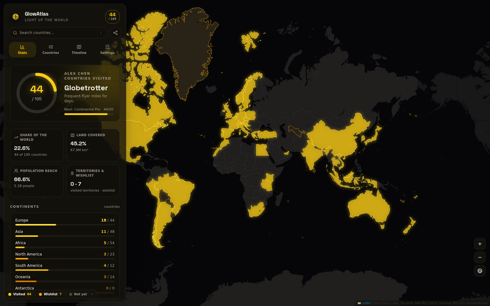
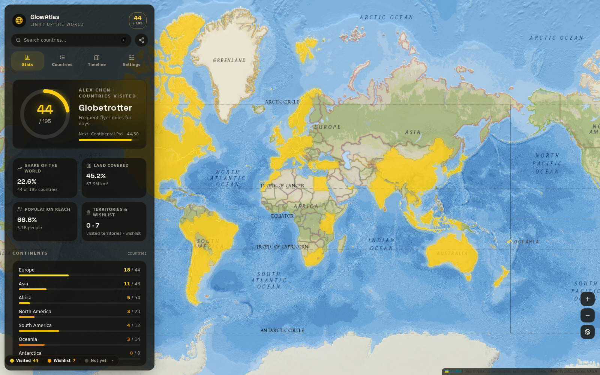
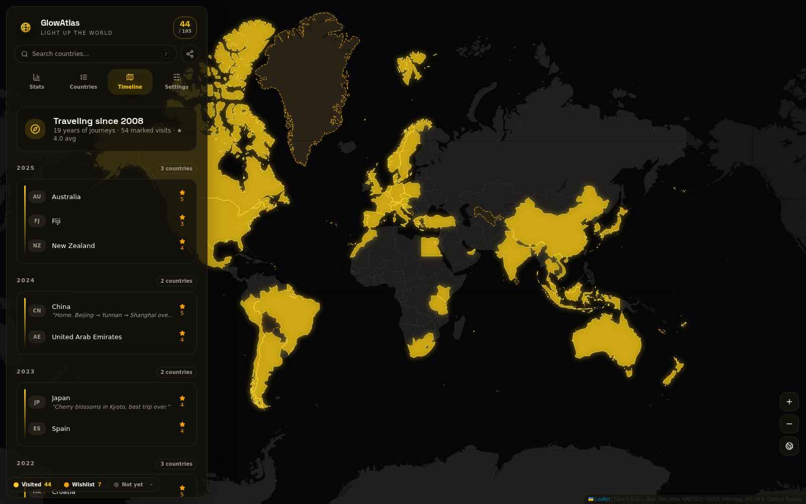
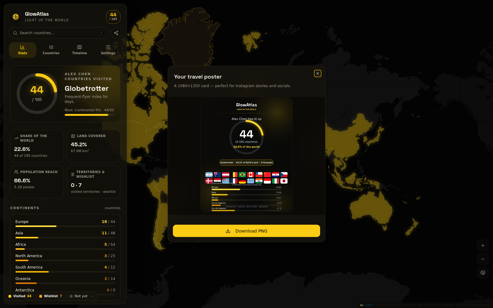
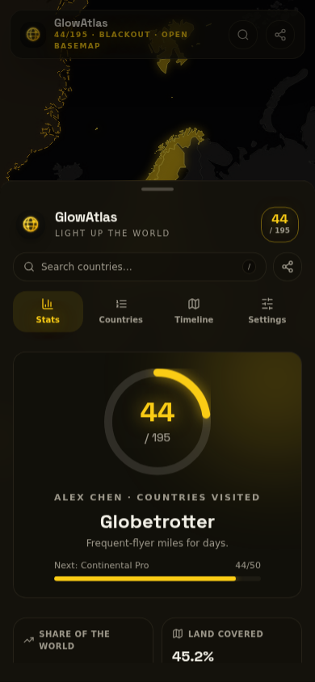
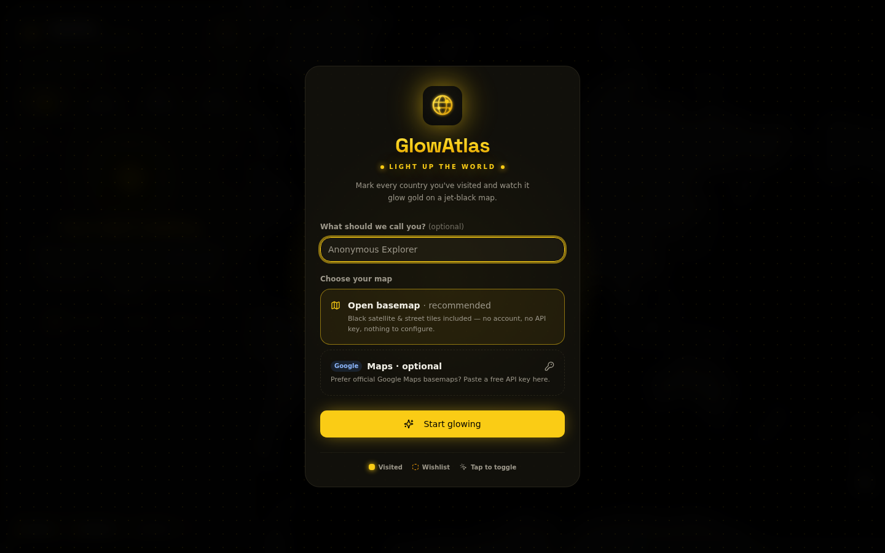

<div align="center">


# GlowAtlas — Light Up the World

**Mark the countries you have visited on a real world map and watch them glow gold on black.**

A "countries been" tracker in the spirit of airline travel-stat apps — but fully
self-hosted, key-optional and yours forever.

[](https://nextjs.org)
[](https://react.dev)
[](https://www.typescriptlang.org)
[](https://developers.google.com/maps)
[](https://leafletjs.com)
[](https://tailwindcss.com)
[](LICENSE)

</div>

---

| Midnight studio | Retro paper |
| --- | --- |
|  |  |

| Travel timeline | Shareable stats poster |
| --- | --- |
|  |  |

| Mobile | Onboarding |
| --- | --- |
|  |  |

## ✨ What it does

Click any country on the planet to **light it up**. GlowAtlas turns that into a
rich personal travel dashboard — the kind of screen you get from
Umetrip / VariFlight country statistics, but for every place your feet have
touched, with no account and no data leaving your browser.

- **🗺 Real world map, two engines** — the official **Google Maps JavaScript
  API** (styled basemaps, data layer) when you supply a key, and a beautiful
  keyless **Esri / OpenStreetMap** basemap engine so the app works instantly
  out of the box. Switch anytime in Settings.
- **🟡 One-tap lighting** — click a country to mark it *Visited* (a solid
  solar-gold glow), *Wishlist* (dashed amber outline) or clear it. Optional
  *quick-tap mode* toggles visited on every click.
- **📊 Flight-app statistics** — X / 195 countries, share of the world, share
  of Earth's land, population reach, territories visited, per-continent
  progress bars.
- **🏆 Explorer levels** — from *Armchair Explorer* to *World Conqueror*,
  with level-up toasts when you cross a threshold.
- **📅 Travel timeline** — every visit dated by year, grouped newest-first,
  with notes and star ratings. "Traveling since 2005 · 21 years of journeys".
- **🔎 Command palette** — press <kbd>/</kbd> to search 252 countries &
  territories and fly to any of them.
- **🖼 Share card generator** — a canvas-rendered 1080×1350 poster with your
  ring stats, flag wall and continent bars. Download PNG or share natively.
- **↔️ Your data, your device** — everything persists in `localStorage`.
  JSON backups, CSV export, full reset.
- **🎨 Black & gold design** — a jet-black canvas with a single solar-gold
  accent: visited countries glow yellow, the UI stays black-and-yellow end
  to end. 4 basemap styles (Blackout / Daylight / Silver / Retro) if you
  ever want a change.
- **📱 Fully responsive** — desktop glass sidebar, mobile bottom-sheet
  dashboard with swipe gestures.

## 🚀 Quickstart

```bash
git clone https://github.com/<you>/glowatlas.git
cd glowatlas
npm install        # or: bun install / pnpm install
npm run dev        # → http://localhost:3000
```

No configuration required — the app boots on the open basemap. To run on
Google Maps, add a key (next section).

### Using Google Maps (optional)

GlowAtlas uses the official **Maps JavaScript API**. Google's free monthly
credit comfortably covers personal use.

1. Open the [Google Cloud Console → Credentials](https://console.cloud.google.com/google/maps-apis/credentials)
   (create a free account if you don't have one).
2. **Create credentials → API key**, then enable the
   **Maps JavaScript API** for that key.
3. Pick either way to give the key to GlowAtlas:

   **a. Environment variable** (recommended for deployments) — copy
   `.env.example` to `.env`:

   ```bash
   NEXT_PUBLIC_GOOGLE_MAPS_API_KEY="AIza…"
   ```

   **b. At runtime** — paste the key in *Settings → Map engine* (or during
   onboarding). It is stored only in your browser's `localStorage`.

4. Reload — the map switches to Google Maps with the styled look.

> 🔒 **Key safety**: a client-side key is public by design. Restrict it to
> your domain(s) in the Console (HTTP referrers) and enable billing alerts.
> An invalid or over-quota key is caught gracefully — GlowAtlas shows a
> friendly banner and can fall back to the open basemap in one click.

### Open Basemap (no key)

Powered by **Esri World Dark/Light Gray Canvas**, **National Geographic** and
**OpenStreetMap** raster tiles — no accounts, no keys, no tracking. Countries
still glow exactly the same.

## 📦 Deployment

### GitHub Pages — one-push deploy (recommended)

The repo ships with a ready-made GitHub Actions workflow
(`.github/workflows/deploy.yml`) that builds the static site and publishes it
to GitHub Pages automatically — no local tooling required:

1. **Create a new repository** on GitHub (any name, e.g. `glowatlas`).
2. **Push this project** to the `main` branch (upload the files, or use git):

   ```bash
   git init && git add -A && git commit -m "GlowAtlas"
   git remote add origin https://github.com/<you>/<repo>.git
   git push -u origin main
   ```

   No git? On the repo page use *Add file → Upload files* and drag the
   extracted archive in, then commit.

3. **Enable Pages** — repo *Settings → Pages → Build and deployment →
   Source: **GitHub Actions***.
4. The workflow fires on every push to `main` (or via *Actions → Deploy to
   GitHub Pages → Run workflow*). Site goes live at
   `https://<you>.github.io/<repo>/` in ~a minute.

The workflow auto-detects the correct base path from the repo name (project
sites get `/<repo>`; `<you>.github.io` and custom domains via a `CNAME` file
get the root). The map, GeoJSON boundaries and logo are all basePath-aware,
so nothing needs configuring.

### Vercel / Netlify

Import the repo, add `NEXT_PUBLIC_GOOGLE_MAPS_API_KEY` if desired, deploy. Done.

### Docker / any VPS

The default build produces a standalone server:

```bash
npm run build            # → .next/standalone
npm run start            # node .next/standalone/server.js (port 3000)
```

### Static export by hand

```bash
npm run build:pages                                     # root deploy → ./out
BUILD_MODE=pages PAGES_BASE_PATH=/<repo-name> \
  npm run build:pages                                   # sub-path deploy → ./out
# push ./out to the gh-pages branch (e.g. with the gh-pages tool)
```

> ⚠️ On GitHub Pages project sites you must set `PAGES_BASE_PATH` to
> `/<repo-name>` (project sites are served from a sub-path). On a custom
> domain or `<user>.github.io` repo, omit it.

## 🗂 Project structure

```
src/
├── app/                     # Next.js 16 App Router shell (layout, page, styles)
├── components/
│   ├── atlas/               # App UI: dashboard, countries list, timeline,
│   │                        # settings, detail dialog, onboarding, search,
│   │                        # share-card generator, shared bits
│   ├── map/                 # MapEngine interface + two engines:
│   │                        #   google-engine.ts  (Google Maps data layer)
│   │                        #   leaflet-engine.ts (Esri/OSM raster tiles)
│   │                        # + MapView React wrapper, Google loader
│   └── ui/                  # shadcn/ui primitives (New York style)
├── data/
│   └── countries-meta.ts    # 252 countries & territories (generated)
├── lib/                     # store (zustand+persist), stats, colors/themes,
│                            # achievements, formatting, export helpers, event bus
└── types/                   # minimal google.maps ambient typings
public/data/countries.geojson  # Natural Earth 50m boundaries (generated)
scripts/prepare-countries.ts   # data pipeline (see below)
```

## 🧾 Data sources

Bundled, generated and regenerable with `bun scripts/prepare-countries.ts`
(or `npm run data`):

- **[Natural Earth](https://www.naturalearthdata.com/)** 4 — 50 m admin-0
  country boundaries (public domain).
- **[mledoze/countries](https://github.com/mledoze/countries)** — common
  names, ISO codes, UN membership, population, area (the dataset behind
  restcountries.com).
- Flags rendered from **[flagcdn.com](https://flagcdn.com)**.
- Basemaps: **Google Maps** (your key) or **Esri** / **OpenStreetMap** tiles.

Statistics follow the travel-app convention of **195 countries**
(193 UN member states + the Holy See + Palestine); remaining entities
(Greenland, Hong Kong, Antarctica…) count as *territories* — visitable,
with their own tally.

## 🛠 Tech stack

Next.js 16 · React 19 · TypeScript · Tailwind CSS 4 · shadcn/ui ·
Zustand (persist) · Framer Motion · vaul · cmdk · sonner · Leaflet ·
Google Maps JS API · Canvas 2D (share cards)

## 📄 License

[MIT](LICENSE) — country geometry and datasets remain under their own
licenses (Natural Earth: public domain; mledoze/countries: ODbL/CC0 — see
upstream). Map tiles are subject to each provider's terms; keep the
attribution line visible.
